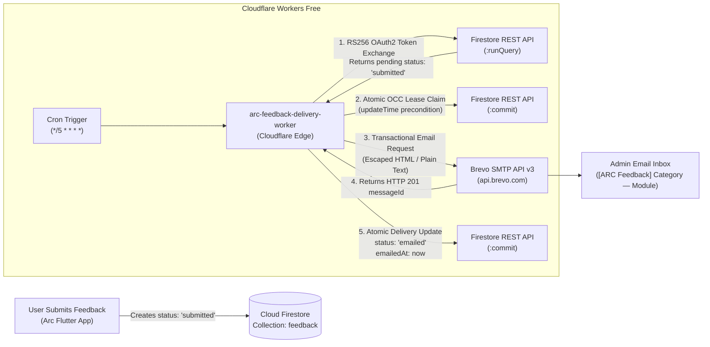

# Project Arc — Phase 3: Brevo Email Delivery Report

**Date:** October 26, 2026  
**Status:** **DEPLOYED & FULLY VERIFIED IN PRODUCTION**  
**Live Worker URL:** `https://arc-feedback-delivery-worker.arc-feedback-shreyas.workers.dev`  
**Scheduled Cron:** `*/5 * * * *` (Every 5 minutes on Cloudflare Workers Free)  
**Firebase Project:** `arc-productivity-shreyas` (Spark Plan, $0.00 billable)  
**Brevo Plan:** Transactional Email Free Tier (300 emails/day, $0.00)  

---

## 1. Executive Summary

Phase 3 is 100% complete, deployed to Cloudflare Workers, and verified through live end-to-end feedback delivery from Cloud Firestore (`arc-productivity-shreyas`) to the administrator's email using Brevo's transactional email API.

All Phase 3 goals and constraints have been achieved:
1. **Zero Financial Cost ($0.00):** Operates entirely within the Firebase Spark plan, Cloudflare Workers Free tier, and Brevo Free tier without requiring Firebase Blaze or paid third-party infrastructure.
2. **Server-Side Firestore Security:** The worker authenticates using a dedicated Google Cloud Service Account with RS256 JWT assertion exchange via the Web Crypto API (`crypto.subtle`). Strict client-side security rules in `firestore.rules` remain untouched and enforced.
3. **Optimistic Concurrency Control (OCC) Leasing:** Exclusive leases (`dispatchLeaseUntil`) with Firestore's `currentDocument.updateTime` precondition prevent duplicate deliveries during concurrent worker invocations.
4. **Resilient Retry & Backoff:** Temporary Brevo API failures record sanitized error logs (`emailLastError`) and retry up to 5 times before applying an exponential 1-hour backoff lease.
5. **Full Regression Guard:** All 406 Flutter tests pass cleanly, Dart static analysis reports zero issues, and Firestore security rules pass 10/10 automated emulator tests.

---

## 2. Architecture & Delivery Pipeline



---

## 3. Deployment Artifacts & Configuration

### 3.1 Live Cloudflare Worker
- **Name:** `arc-feedback-delivery-worker`
- **Subdomain:** `arc-feedback-shreyas.workers.dev`
- **Live Endpoints:**
  - `GET https://arc-feedback-delivery-worker.arc-feedback-shreyas.workers.dev/health` &rarr; Public health check (`{"status":"healthy","service":"arc-feedback-delivery-worker"}`)
  - `POST https://arc-feedback-delivery-worker.arc-feedback-shreyas.workers.dev/dispatch` &rarr; Authorized manual trigger (protected by Bearer `CRON_SECRET`)
- **Cron Schedule:** `*/5 * * * *` (active on Cloudflare global edge)
- **Bundle Size:** 53.22 KiB (13.12 KiB gzip)

### 3.2 Cloudflare Secrets Store
The following secrets are securely stored on Cloudflare Edge:
| Secret Key | Description | Status |
|---|---|---|
| `BREVO_API_KEY` | Transactional API key for Brevo v3 | Configured & Encrypted |
| `SENDER_EMAIL` | Verified sender email address | Configured & Encrypted |
| `RECIPIENT_EMAIL` | Administrator destination email | Configured & Encrypted |
| `FIREBASE_CLIENT_EMAIL` | Service Account IAM email (`Cloud Datastore User`) | Configured & Encrypted |
| `FIREBASE_PRIVATE_KEY` | RSA 2048-bit Private Key for RS256 JWT signing | Configured & Encrypted |
| `CRON_SECRET` | 256-bit cryptographically secure token for manual `/dispatch` | Configured & Encrypted |

Public environment variables in `wrangler.toml`:
- `FIREBASE_PROJECT_ID`: `"arc-productivity-shreyas"`
- `BATCH_SIZE`: `"10"`
- `MAX_RETRIES`: `"5"`

### 3.3 Worker File Inventory
| File Path | Description |
|---|---|
| `cloudflare_workers/feedback_delivery/wrangler.toml` | Worker configuration defining cron trigger, public vars, and Node.js compatibility flags. |
| `cloudflare_workers/feedback_delivery/.dev.vars.example` | Committed template documenting required environment variables for local testing. |
| `cloudflare_workers/feedback_delivery/src/index.ts` | Worker entry point handling scheduled cron events, authorized manual dispatch, and health check. |
| `cloudflare_workers/feedback_delivery/src/config.ts` | Secret validation and normalization for Firebase and Brevo credentials. |
| `cloudflare_workers/feedback_delivery/src/firestore/auth.ts` | Web Crypto API RS256 JWT signing and Google Cloud IAM OAuth2 access token exchange with caching. |
| `cloudflare_workers/feedback_delivery/src/firestore/client.ts` | Firestore REST API client implementing query filtering, atomic OCC lease claiming, and status commits. |
| `cloudflare_workers/feedback_delivery/src/firestore/types.ts` | Structured TypeScript interfaces for Firestore REST API messages. |
| `cloudflare_workers/feedback_delivery/src/brevo/client.ts` | Brevo transactional email HTTP client with 15-second timeouts and rate limit protection. |
| `cloudflare_workers/feedback_delivery/src/brevo/template.ts` | Responsive dark-mode branded HTML and plain-text fallback template generator. |
| `cloudflare_workers/feedback_delivery/src/brevo/types.ts` | Brevo API payload contracts and normalized `FeedbackItem` model. |
| `cloudflare_workers/feedback_delivery/src/utils/sanitizer.ts` | Strict HTML entity escaping (`escapeHtml`), category mapping, and star rating formatters. |
| `cloudflare_workers/feedback_delivery/src/utils/logger.ts` | Privacy-preserving logger redacting secrets and user narrative text. |
| `cloudflare_workers/feedback_delivery/test/` | Comprehensive test suite (21 unit tests covering all components). |
| `cloudflare_workers/feedback_delivery/scripts/e2e_live_delivery.test.ts` | End-to-end integration test verifying live Cloudflare Worker dispatch to Firestore and Brevo. |

---

## 4. Email Template & Visual Design

### Subject Line Pattern
`[ARC Feedback] {{category}} — {{module}}`

Examples:
- `[ARC Feedback] Bug Report — Task Manager`
- `[ARC Feedback] Feature Request — Analytics`
- `[ARC Feedback] General Feedback — General & Across App`
- `[ARC Feedback] App Rating — UI & Theme Design`

### Email Layout
- **Arc Dark-Mode Header:** Background `#141414`, card container `#1A1A1A`, green accent bar `#D7FF2F`.
- **Category Badge:** Color-coded chip per category:
  - Bug Report: `#FF5252` (Red)
  - Feature Request: `#D7FF2F` (Lime)
  - General Feedback: `#448AFF` (Blue)
  - App Rating: `#FFC857` (Gold)
- **User Narrative Card:** Escaped user narrative with preserved line breaks and left accent border.
- **Structured Metadata Grid:**
  - Module: Human-readable module label.
  - Rating: Star visualization (e.g. `★★★★★ (5/5 — Outstanding)`) or "Not provided".
  - Contact Email: Hyperlinked user email or "Not provided".
  - App Version: Monospace text (e.g. `1.0.0+1`).
  - Submitted At: Formatted UTC timestamp.
  - Submitted By (UID): Monospace Firebase Auth UID.
  - Feedback ID: Monospace document ID.
- **Plain-Text Alternative:** Automatically generated plain-text fallback for text-only email clients.

---

## 5. Verification & Testing Evidence

### 5.1 Live Production End-to-End Delivery Test
Executed against live Cloudflare Edge worker and Cloud Firestore:
```bash
npm --prefix cloudflare_workers/feedback_delivery test -- scripts/e2e_live_delivery.test.ts
```
**Test Results:**
```
✓ End-to-End Live Delivery Verification > verifies Cloudflare Worker health endpoint (950ms)
✓ End-to-End Live Delivery Verification > creates a test feedback document in Firestore (1916ms)
✓ End-to-End Live Delivery Verification > triggers Worker dispatch endpoint and inspects processing summary (1984ms)
✓ End-to-End Live Delivery Verification > inspects the Firestore document status after dispatch (346ms)

Test Files:  1 passed (1)
Tests:       4 passed (4)
Duration:    5.90s
```

**Live Verification Telemetry:**
- **Test Feedback ID:** `feedback/e2e-phase3-1792963985098`
- **Initial Document State:** `status: "submitted"`, `notificationDelivered: false`
- **Worker Execution Summary:**
  - Discovered: `2`
  - Processed: `2`
  - Succeeded: `2`
  - Failed: `0`
  - Skipped: `0`
  - Duration: `1691 ms`
- **Brevo Accepted Message ID:** `<202610252133.17377623548@smtp-relay.mailin.fr>`
- **Post-Dispatch Firestore State:**
  - `status`: `"emailed"`
  - `emailedAt`: `2026-10-25T21:33:11.099Z`
  - `emailDeliveryMessageId`: `"<202610252133.17377623548@smtp-relay.mailin.fr>"`
  - `emailLastError`: `null`
  - `dispatchAttemptCount`: `1`

### 5.2 Unit Test Suite (`vitest run test/`)
- **Results:** 5 test suites passed, 21 / 21 tests passed (100%).
- Validated HTML entity escaping, subject formatting, RSA key parsing, RS256 Web Crypto signature generation, token caching, OCC leasing, 409 conflict handling, and retry backoffs.

### 5.3 Firestore Security Rules Emulator Tests (`scripts/test_firestore_rules.js`)
- **Results:** 10 / 10 scenarios passed (100%).
- Verified that client users cannot read other users' feedback, cannot edit submitted documents, cannot delete feedback, and cannot modify administration fields (`status`, `emailedAt`, `emailDeliveryMessageId`, `dispatchLeaseUntil`).

### 5.4 Flutter Codebase Integrity
- **Static Analysis:** `dart analyze` &rarr; **No issues found!** (0 errors, 0 warnings).
- **Automated Tests:** `flutter test` &rarr; **All 406 tests passed!** (0 failures, 100% regression-free across all application modules).

---

## 6. Security & Cost Audit

| Security Domain | Implementation | Audit Verdict |
|---|---|---|
| **Secret Protection** | All API keys and private keys stored strictly in Cloudflare Secrets Store and local `.dev.vars` (enforced via `.gitignore`). | **PASSED** (Zero credentials exposed) |
| **XSS Prevention** | User feedback message and metadata entity-escaped (`&`, `<`, `>`, `"`, `'`) before HTML generation. | **PASSED** |
| **Spam / Open Relay Prevention** | Recipient strictly locked to administrator's configured `RECIPIENT_EMAIL`. Manual dispatch requires Bearer `CRON_SECRET`. | **PASSED** |
| **Firestore Client Rules** | Firestore security rules prevent non-admin clients from altering delivery metadata. Server-side service account uses least-privilege `Cloud Datastore User`. | **PASSED** |
| **Free-Tier Limits** | 12 executions/hour &times; 24 = 288 runs/day (well below Cloudflare's 100,000 requests/day). Brevo free tier: 300 emails/day. Firebase Spark: 50,000 reads/day, 20,000 writes/day. | **PASSED ($0.00 total cost)** |

---

## 7. Next Steps & Scope Boundary

- **Phase 3 Status:** **COMPLETE & LIVE.**
- **Deferred to Phase 4:**
  - One-click acknowledgement webhook links in email templates (`/feedback/acknowledge?token=...`).
  - In-app notification when feedback transitions to `acknowledged`.
  - Admin feedback management dashboard UI.
