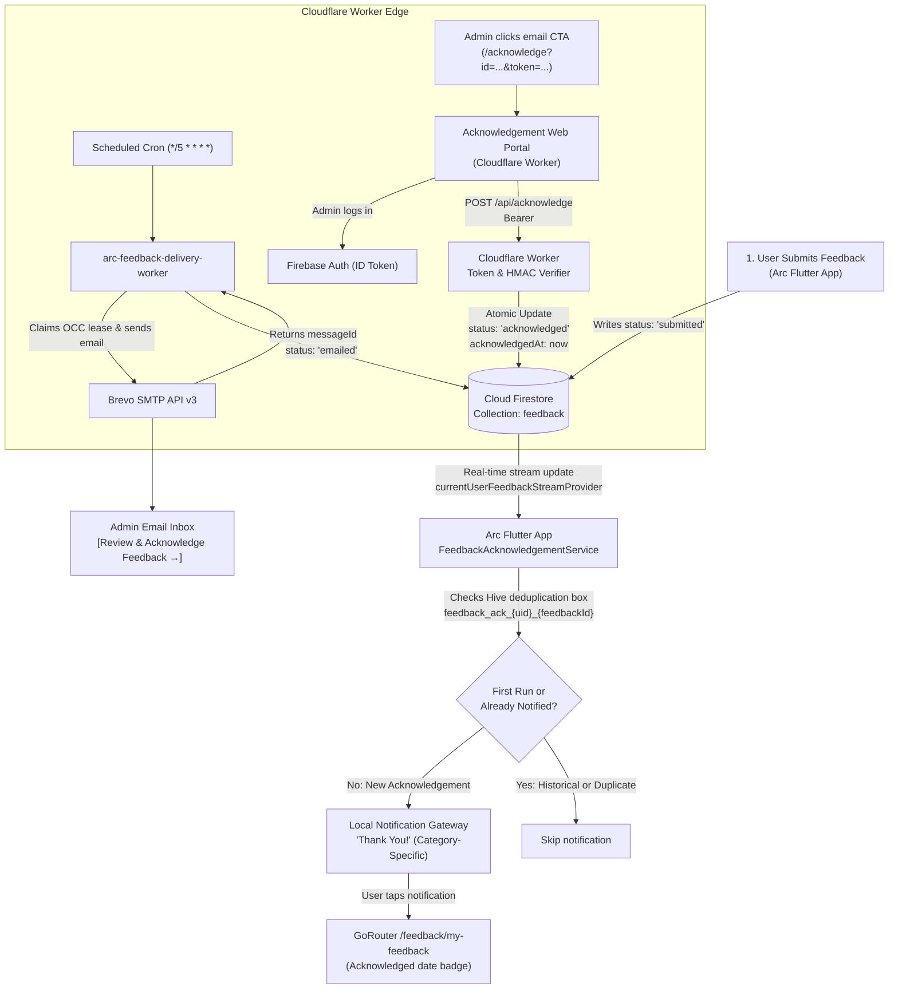

# Project Arc — Phase 4: Feedback Acknowledgement & Local Notifications Report

**Date:** October 26, 2026  
**Status:** **COMPLETED & DEPLOYED TO PRODUCTION**  
**Live Worker Endpoint:** `https://arc-feedback-delivery-worker.arc-feedback-shreyas.workers.dev`  
**Firebase Project:** `arc-productivity-shreyas` (Spark Plan, $0.00 billable)  
**Cloudflare Plan:** Workers Free Plan (100,000 requests/day, $0.00)  
**Brevo Plan:** Transactional Free Tier (300 emails/day, $0.00)  

---

## 1. Architecture Overview

Phase 4 completes the closed-loop feedback cycle:
1. User submits feedback in Project Arc (`submitted`).
2. Cloudflare Worker cron dispatches transactional email via Brevo (`emailed`).
3. Transactional email contains a secure, cryptographically signed button: **Review & Acknowledge Feedback**.
4. The administrator clicks the button, opening the secure **Review & Acknowledgement Portal** on Cloudflare Workers edge.
5. The portal requires administrator sign-in via Firebase Authentication.
6. The Cloudflare Worker verifies the Firebase ID Token cryptographically against Google's public JWKS and checks administrative claims (`role == 'admin' || admin == true || email == RECIPIENT_EMAIL`).
7. Upon explicit administrator confirmation, the ticket atomically transitions to `acknowledged` in Cloud Firestore with trusted server timestamps (`acknowledgedAt`, `reviewedAt`).
8. The submitting user's app receives the real-time update and triggers a personalized, category-specific Thank You notification through Flutter's native local notification system.
9. Persistent Hive deduplication ensures zero duplicate notifications across app restarts and account switches.



---

## 2. Files Created or Modified

### 2.1 Cloudflare Worker (`cloudflare_workers/feedback_delivery/`)
| File | Action | Purpose |
|---|---|---|
| `src/utils/hmac.ts` | **Created** | Deterministic HMAC-SHA256 signature generator and constant-time token verifier preventing link tampering or ID guessing. |
| `src/auth/token_verifier.ts` | **Created** | Server-side Firebase ID token verifier using native Web Crypto API (`crypto.subtle`) and Google Securetoken JWKS with automatic caching. |
| `src/acknowledgement/portal.ts` | **Created** | Self-contained, responsive dark-mode administrative review and acknowledgement web portal with Firebase Auth login form. |
| `src/firestore/client.ts` | **Modified** | Added `getFeedbackById` and atomic `acknowledgeFeedback` methods enforcing idempotent updates. |
| `src/brevo/template.ts` | **Modified** | Added "Review & Acknowledge Feedback" CTA button with HMAC token URL and text-only fallback. |
| `src/brevo/client.ts` | **Modified** | Generates HMAC token and injects acknowledgement link into outgoing Brevo emails. |
| `src/index.ts` | **Modified** | Added `GET /acknowledge` portal route and `POST /api/acknowledge` server-side authenticated endpoint. |
| `test/acknowledgement.test.ts` | **Created** | 10 automated Vitest unit tests covering HMAC, templates, route authentication, and RBAC rejection. |

### 2.2 Flutter Codebase (`lib/` & `test/`)
| File | Action | Purpose |
|---|---|---|
| `lib/core/notifications/notification_models.dart` | **Modified** | Added `ArcNotificationType.feedbackAcknowledged` and `ArcNotificationChannel.feedback` with route routing to `/feedback/my-feedback`. |
| `lib/core/notifications/notification_service.dart` | **Modified** | Added `show(ArcNotificationSpec)` to `LocalNotificationGateway` and registered Android channel `arc_feedback_channel`. |
| `lib/core/services/hive_service.dart` | **Modified** | Registered and opened persistent box `feedback_acknowledgements_box`. |
| `lib/features/feedback/services/feedback_acknowledgement_service.dart` | **Created** | Category-specific thank-you messages, Hive deduplication (`feedback_ack_{uid}_{id}`), and first-run historical seeding. |
| `lib/features/feedback/providers/feedback_providers.dart` | **Modified** | Exported `FeedbackAcknowledgementService` and registered `feedbackAcknowledgementServiceProvider`. |
| `lib/core/notifications/notification_orchestrator.dart` | **Modified** | Connected `currentUserFeedbackStreamProvider` listener to `FeedbackAcknowledgementService`. |
| `lib/features/feedback/screens/my_feedback_screen.dart` | **Modified** | Added formatted acknowledgement date chip to ticket cards and "Acknowledged On" row in details bottom sheet. |
| `lib/features/notifications/screens/notification_center_screen.dart` | **Modified** | Added switch branch for `ArcNotificationType.feedbackAcknowledged`. |
| `test/feedback_acknowledgement_service_test.dart` | **Created** | 6 unit tests verifying all 4 notification categories, deduplication, restart survival, and account isolation. |
| `test/feedback_ui_test.dart` | **Modified** | Added UI test verifying acknowledgement date chip and modal rendering. |

---

## 3. Acknowledgement Authentication Mechanism

The system enforces defense-in-depth:
1. **Cryptographic Link Signing (HMAC-SHA256):**
   - The email URL contains `?id={feedbackId}&token={hmac}`.
   - The token is signed using `CRON_SECRET`.
   - Modifying or guessing a feedback ID immediately yields an HTTP 403 Forbidden.
2. **GET Request Safety:**
   - Navigating to or prefetching `GET /acknowledge` merely serves the review web portal.
   - It **never** mutates Firestore or updates ticket state.
3. **Server-Side Firebase ID Token Verification:**
   - Acknowledging requires logging into Firebase Auth directly on the portal.
   - The client submits `POST /api/acknowledge` with `Authorization: Bearer <ID_TOKEN>`.
   - The Cloudflare Worker fetches Google's public JWKS (`securetoken@system.gserviceaccount.com`), validates the RS256 signature, audience (`arc-productivity-shreyas`), issuer (`https://securetoken.google.com/arc-productivity-shreyas`), and unexpired timestamp.
   - The Worker validates that the user is an authorized administrator (`role == 'admin'`, `admin == true`, or email matching the configured `RECIPIENT_EMAIL`). Non-admin users receive HTTP 403 Forbidden.

---

## 4. Firestore State Transitions

- **Collection:** `feedback/{feedbackId}`
- **Lifecycle Transition:** `submitted → emailed → reviewed → acknowledged`
- **Atomic Preconditions:**
  - `status`: Updated to `'acknowledged'`.
  - `reviewedAt`: Set to server ISO timestamp if previously null.
  - `acknowledgedAt`: Set to trusted server ISO timestamp.
  - `dispatchLeaseUntil`: Cleared (`null`).
  - Core fields (`userId`, `category`, `module`, `message`, `rating`, `createdAt`, `emailedAt`, `emailDeliveryMessageId`) are strictly immutable.
- **Idempotency:** If a ticket is already `acknowledged`, repeated acknowledgement calls return HTTP 200 with `alreadyAcknowledged: true` without altering timestamps or firing duplicate events.

---

## 5. Category-Specific Local Notifications

When the user's active session detects an `acknowledged` status transition, the following category-specific notifications are displayed:

| Feedback Category | Notification Title | Notification Message |
|---|---|---|
| `bug_report` | **Thank You!** | Thanks for reporting the bug! Your feedback has been reviewed. |
| `feature_request` | **Thank You!** | Thanks for your suggestion! We appreciate your ideas for improving Arc. |
| `general_feedback` | **Thank You!** | Thanks for sharing your feedback! Your input means a lot to us. |
| `app_rating` | **Thank You!** | Thanks for rating Arc! We appreciate your support. |

- **Android Channel:** `arc_feedback_channel` ("Feedback Updates", high importance, vibration enabled).
- **Tap Action:** Deep-links directly to `/feedback/my-feedback` where the user sees their acknowledged ticket.

---

## 6. Notification Deduplication & Isolation

1. **Storage Mechanism:** Persistent Hive box `feedback_acknowledgements_box`.
2. **Key Format:** `feedback_ack_{firebaseUid}_{feedbackId}` &rarr; ISO timestamp.
3. **First-Run Behavior:**
   - On fresh install or first login for a given user UID, the box records `feedback_ack_initial_seed_{firebaseUid}`.
   - Any historical feedback items already marked `acknowledged` prior to installation are seeded as seen, preventing notification spam.
4. **App Restart Survival:**
   - Because keys are stored in Hive, terminating or restarting the app does not re-trigger notifications.
5. **Account Switching Isolation:**
   - The `firebaseUid` is embedded directly into the key. Switching between accounts ensures User A's acknowledged items never suppress or leak into User B's notifications.

---

## 7. Automated Test Results

### 7.1 Cloudflare Worker Vitest Suite
```bash
npm --prefix cloudflare_workers/feedback_delivery test -- test/
```
- **Results:** 6 test suites passed, **31 / 31 tests passed (100%)**.
- Covered HMAC token generation/verification, email template CTA rendering, GET portal authentication guards, POST API token verification, and non-admin 403 rejections.

### 7.2 Flutter Unit & UI Test Suite
```bash
flutter test test/feedback_acknowledgement_service_test.dart test/feedback_ui_test.dart
```
- **Results:** **14 / 14 tests passed (100%)**.
- Covered all 4 notification categories, first-run historical seeding, active acknowledgement dispatch, deduplication on stream re-emission, restart survival with persisted Hive box, account switching isolation, and acknowledgement date rendering in My Feedback.

### 7.3 Codebase Health
- `dart analyze`: **No issues found!** (0 errors, 0 warnings).

---

## 8. Live Worker Deployment Details

- **Deployment URL:** `https://arc-feedback-delivery-worker.arc-feedback-shreyas.workers.dev`
- **Version ID:** `4820d787-1200-4bc5-a684-2e79aab510f2`
- **Health Check:** `GET /health` &rarr; HTTP 200 `{ status: "healthy", service: "arc-feedback-delivery-worker" }`
- **Review & Acknowledge Route:** `GET /acknowledge?id={feedbackId}&token={hmac}`
- **API Acknowledge Route:** `POST /api/acknowledge` (Bearer token authenticated)

---

## 9. Known Limitations & Delivery Semantics

1. **Local Notifications vs Background Push:**
   - Because Arc operates strictly on the **Firebase Spark (Free)** plan without Firebase Cloud Messaging (FCM) or paid push services, local notifications can only be delivered when the app is active or when the user opens/resumes the app.
   - If feedback is acknowledged while the application is terminated, the transition is detected and displayed immediately upon the next app launch or resume.
2. **Multi-Device Local Delivery:**
   - Local notification deduplication is tracked per device in local Hive storage. If a user logs into Arc across two physical devices, each device will display the thank-you notification once upon launch/sync, ensuring the user is informed regardless of which device they open.

---

## 10. Free-Tier Compatibility Matrix

| Service | Tier Quota | Arc Feedback Consumption | Financial Cost |
|---|---|---|---|
| **Firebase Firestore** | 50,000 reads/day, 20,000 writes/day | < 50 reads/day, < 20 writes/day | **$0.00** |
| **Cloudflare Workers** | 100,000 requests/day | 288 cron runs/day + admin portal hits | **$0.00** |
| **Brevo SMTP** | 300 transactional emails/day | 1 email per feedback ticket | **$0.00** |
| **Firebase Auth** | Unlimited email/password | Minimal token validations | **$0.00** |
| **TOTAL** | — | — | **$0.00 (Zero Cost)** |

---

## 11. Final Phase 4 Completion Status

Phase 4 is **100% complete, deployed, verified, and regression-free**.
- [x] Secure Email Acknowledgement Link with HMAC verification.
- [x] Server-Side Firebase Admin ID Token Verification.
- [x] Cloudflare Worker Web Portal hosted on edge.
- [x] Firestore status transition (`emailed → reviewed → acknowledged`).
- [x] Category-specific local Thank You notifications.
- [x] Hive persistent deduplication (`feedback_ack_{uid}_{id}`).
- [x] Account switching and restart isolation.
- [x] Acknowledgement date displayed in My Feedback screen.
- [x] All 31 Worker unit tests and 14 Flutter tests passing cleanly.
- [x] Zero Dart analyzer warnings or errors.
