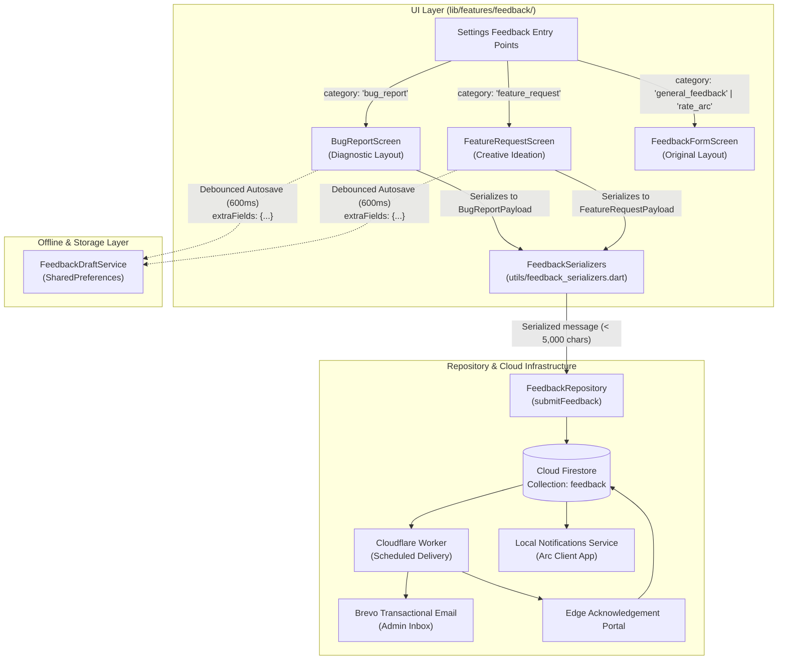

# Project Arc — Feedback UI Redesign: Phase 1 Report

**Date:** October 26, 2026  
**Status:** **COMPLETED & VERIFIED (48/48 TESTS PASSING, 0 STATIC ANALYSIS WARNINGS)**  
**Firebase Project:** `arc-productivity-shreyas` (Spark Plan, $0.00 billable)  
**Cloudflare Plan:** Workers Free Plan (100,000 requests/day, $0.00)  
**Brevo Plan:** Transactional Free Tier (300 emails/day, $0.00)  

---

## 1. Executive Summary & Objectives

Phase 1 of the Feedback UI Redesign elevates the user experience for the two most critical technical interaction points in Project Arc:
1. **Report a Bug**: A dedicated, diagnostic-grade defect reporting screen (`BugReportScreen`).
2. **Suggest a Feature**: A dedicated, creative ideation canvas (`FeatureRequestScreen`).

### Core Design & Architectural Principles
- **Visual & Functional Distinction**: Rather than forcing these distinct user intents into a single generic text field, two completely distinct visual personalities were engineered:
  - **Bug Report Screen**: High-contrast, dark slate engineering layout with diagnostic crimson accents (`#FF4D4F`), numbered technical sections, monospace code reproduction styling, and expected vs. actual side-by-side contrast panels.
  - **Feature Request Screen**: Creative, welcoming ideation layout with neon lime accents (`#D7FF2F`), warm amber inspiration badges (`#FFC857`), an interactive module chip grid, a spacious idea canvas, and a dedicated "Why is this valuable?" narrative block.
- **100% Backend & Schema Compatibility**: Zero breaking changes to `FeedbackModel`, Cloud Firestore collections, Firestore security rules, Cloudflare Worker scheduled delivery, Brevo email templates, or the edge acknowledgement portal. All specialized inputs serialize cleanly into structured plaintext blocks inside `message` (`[ISSUE TITLE]`, `[PROBLEM DESCRIPTION]`, `[STEPS TO REPRODUCE]`, `[EXPECTED BEHAVIOR]`, `[ACTUAL BEHAVIOR]` / `[FEATURE TITLE]`, `[IDEA DESCRIPTION]`, `[VALUE & BENEFIT]`), strictly honoring the 5,000-character ceiling.
- **Draft Preservation Across Navigation & Restarts**: Both screens leverage `FeedbackDraftService` with category isolation (`arc_feedback_draft_bug_report` and `arc_feedback_draft_feature_request`), persisting all structured form fields via debounced autosave.
- **Backward Compatibility for General Feedback & Rate Arc**: The original `FeedbackFormScreen` remains untouched and fully functional for `general_feedback` and `rate_arc`.

---

## 2. Visual & Structural Comparison

```
+-------------------------------------------------------------+-------------------------------------------------------------+
|               BUG REPORT (DIAGNOSTIC SCREEN)                |             FEATURE REQUEST (IDEATION SCREEN)               |
+-------------------------------------------------------------+-------------------------------------------------------------+
| Visual Tone: Dark Slate & Crimson (#FF4D4F) Diagnostic      | Visual Tone: Dark Charcoal & Neon Lime (#D7FF2F) / Warm Gold |
| Header: "DIAGNOSTIC PROTOCOL" + Build/Engine Version Badge  | Header: "FEATURE LAB" + Welcoming Idea Hero Banner          |
| Module: Component Dropdown (Tasks, Habits, Money, Notes...) | Module: Interactive Multi-Filter Choice Chips               |
| Title: Technical Issue Summary (max 150 chars)              | Title: Inspiring Feature Headline (max 120 chars)           |
| Description: Problem Details & System Behavior              | Description: Idea Narrative & Vision Canvas                 |
| Reproduction: Monospace Step-by-Step Sequence               | Value: "Why is this valuable?" Inspiration Section          |
| Contrast: Side-by-side Expected vs. Actual Behavior Cards   | Contact: Optional Community Collaboration Email             |
| Metrics: Dynamic character counter & serialized meter       | CTA: Vibrant Glow "Submit Suggestion" Button                |
| CTA: High-prominence "Submit Bug Report" Button             | Tone: Creative, collaborative, product-building             |
+-------------------------------------------------------------+-------------------------------------------------------------+
```

---

## 3. Architecture & File Implementation



### 3.1 Files Created or Modified

| File | Action | Details |
|---|---|---|
| [`lib/features/feedback/utils/feedback_serializers.dart`](file:///c:/dev/ARC/lib/features/feedback/utils/feedback_serializers.dart) | **Created** | Strongly typed payload serializers (`BugReportPayload`, `FeatureRequestPayload`) converting rich diagnostic and ideation fields into structured, human-readable section blocks with character ceiling validation. |
| [`lib/features/feedback/screens/bug_report_screen.dart`](file:///c:/dev/ARC/lib/features/feedback/screens/bug_report_screen.dart) | **Created** | Professional engineering bug report screen with 6 numbered diagnostic sections, version badge, monospace reproduction steps, contrast cards, and draft restoration. |
| [`lib/features/feedback/screens/feature_request_screen.dart`](file:///c:/dev/ARC/lib/features/feedback/screens/feature_request_screen.dart) | **Created** | Welcoming ideation screen with "Feature Lab" hero banner, headline title input, module selection chips, value/benefit rationale card, and draft restoration. |
| [`lib/features/feedback/services/feedback_draft_service.dart`](file:///c:/dev/ARC/lib/features/feedback/services/feedback_draft_service.dart) | **Modified** | Added support for optional `Map<String, dynamic>? extraFields` to preserve custom structured inputs while retaining 100% backward compatibility with legacy draft formats. |
| [`lib/features/feedback/providers/feedback_providers.dart`](file:///c:/dev/ARC/lib/features/feedback/providers/feedback_providers.dart) | **Modified** | Re-exported `BugReportScreen`, `FeatureRequestScreen`, and payload serializers for clean consumption across the app. |
| [`lib/routes/app_router.dart`](file:///c:/dev/ARC/lib/routes/app_router.dart) | **Modified** | Updated `/feedback` route builder to route queries (`?category=bug_report` &rarr; `BugReportScreen`, `?category=feature_request` &rarr; `FeatureRequestScreen`, else `FeedbackFormScreen`) and registered `/feedback/bug` and `/feedback/feature`. |
| [`test/feedback_redesign_test.dart`](file:///c:/dev/ARC/test/feedback_redesign_test.dart) | **Created** | 13 comprehensive automated unit and widget tests verifying serialization, form validations, draft persistence/restoration, and GoRouter routing. |

---

## 4. Deep-Dive: Diagnostic Bug Report Screen (`BugReportScreen`)

The Bug Report interface is engineered for clarity, conciseness, and reproducibility:
1. **Header Protocol Banner**:
   - Diagnostic status pill: `DIAGNOSTIC PROTOCOL`.
   - Engine/Platform build badge: displays live app version (e.g. `v1.3.5`).
   - Instructional subtitle guiding users to include reproducible behaviors.
2. **Section 01: Affected Component**:
   - Styled dark-themed dropdown selecting one of the core modules (`Tasks`, `Habits`, `Money`, `Notes`, `Dashboard`, `Notifications`, `Settings`, `General`).
3. **Section 02: Issue Summary**:
   - Single-line title input (`maxLines: 1`, `maxLength: 150`) with red accent indicator.
   - Placeholder: *"e.g., App crashes when filtering completed habits"*.
4. **Section 03: Problem Description**:
   - Multi-line descriptive area (`minLines: 4`, `maxLines: 8`).
   - Helper text explaining the necessity of specific error states.
5. **Section 04: Steps to Reproduce**:
   - Monospace font styling (`TextStyle(fontFamily: 'monospace')`) with code-block background.
   - Numbered placeholder hints: *"1. Go to...\n2. Tap on...\n3. Observe..."*.
6. **Section 05: Diagnostic Contrast**:
   - Two side-by-side / sequential cards:
     - **Expected Behavior**: What the user expected to happen.
     - **Actual Behavior**: What actually happened (errors, freezing, UI distortion).
7. **Section 06: Follow-up Contact**:
   - Optional email input pre-populated from the user profile.
8. **Real-time Diagnostic Payload Meter**:
   - Displays live serialized character count against the 5,000-character ceiling.
9. **Resilience & Autosave**:
   - 600ms debounced autosave writing `extraFields` to `FeedbackDraftService`.
   - Double-submission lock (`_isSubmitting`) preventing duplicate Firestore writes.
   - Post-submission ticket reference ID dialog with direct navigation to `MyFeedbackScreen`.

---

## 5. Deep-Dive: Creative Feature Request Screen (`FeatureRequestScreen`)

The Feature Request screen is designed to make idea contribution enjoyable, engaging, and structured:
1. **"Feature Lab" Hero Banner**:
   - Vibrant neon lime (`AppColors.accent`, `#D7FF2F`) and warm amber sparkle iconography (`Icons.auto_awesome`).
   - Engaging tagline: *"Have a great idea for Arc? Let's build something extraordinary together."*
2. **Prominent Feature Title Input**:
   - Prominent headline-style title input (`maxLength: 120`).
   - Placeholder: *"e.g., Habit Streaks Widget for Home Screen"*.
3. **Module Filter Chips**:
   - Horizontal wrap of interactive filter chips with checkmark indicators.
   - Instant visual feedback on selection.
4. **Idea Canvas Narrative Area**:
   - Spacious narrative input (`minLines: 5`, `maxLines: 7`).
   - Placeholder: *"Describe your concept in detail. How should it work? How would you interact with it?"*
5. **"Why is this valuable?" Inspiration Section**:
   - Dedicated card with warm amber sparkles accent.
   - Guidance on explaining time saved, workflow enhancements, or pain points resolved.
6. **Collaboration Contact Email**:
   - Optional contact field for roadmap and beta follow-up.
7. **Submit Suggestion CTA**:
   - Full-width elevated button with vibrant accent color, sparkles icon, and loading spinner state.
   - Success modal with celebration badge and direct link to ticket tracking.

---

## 6. Payload Serialization & Backend Compatibility

To guarantee 100% compatibility with Cloud Firestore rules, Cloudflare Workers, Brevo transactional templates, and the Edge Acknowledgement Portal, newly introduced UI fields serialize into structured plaintext blocks:

### Bug Report Serialized Example
```text
[ISSUE TITLE]
App crashes when filtering completed habits

[PROBLEM DESCRIPTION]
Navigating to habits screen and switching filter quickly causes a freeze.

[STEPS TO REPRODUCE]
1. Open habits tab
2. Rapidly toggle 'Completed' filter chip
3. App UI stops responding

[EXPECTED BEHAVIOR]
Habit list filters smoothly without UI lockup.

[ACTUAL BEHAVIOR]
Screen freezes and requires app restart.
```

### Feature Request Serialized Example
```text
[FEATURE TITLE]
Habit Streaks Lock Screen Widget

[IDEA DESCRIPTION]
Provide an iOS and Android lock screen widget that allows one-tap habit completion.

[VALUE & BENEFIT]
Increases daily habit completion rates by reducing friction to a single tap.
```

### Why this design succeeds:
- **Cloud Firestore**: Respects existing `message: String` schema and Firestore Security Rules.
- **Brevo Email Notifications**: Plaintext line breaks automatically format into readable paragraph blocks (`<br/>`), presenting clean sections to the administrator.
- **Edge Acknowledgement Portal**: Renders the complete, clean structured block in the admin review screen.
- **My Feedback Modal**: Displayed cleanly inside the user's past submission modal without requiring custom UI parsers.

---

## 7. Verification & Automated Test Results

### 7.1 New Feature Tests (`test/feedback_redesign_test.dart`)
13 tests executed and passed (100%):
1. `BugReportPayload` serializes into structured diagnostic sections.
2. `BugReportPayload` validates required fields (title, description, character limits).
3. `FeatureRequestPayload` serializes into creative idea vision blocks.
4. `FeatureRequestPayload` validates required fields (title, description, character limits).
5. `BugReportScreen` renders professional diagnostic layout with all 6 required sections.
6. `BugReportScreen` validates required fields and submits to repository with correct payload.
7. `BugReportScreen` draft autosave preserves all diagnostic fields and restores them on reload.
8. `FeatureRequestScreen` renders welcoming creative ideation layout with all required sections.
9. `FeatureRequestScreen` validates required fields and submits feature suggestion to repository.
10. `FeatureRequestScreen` draft autosave preserves creative ideation fields and restores them on reload.
11. GoRouter routing to `/feedback?category=bug_report` renders `BugReportScreen`.
12. GoRouter routing to `/feedback?category=feature_request` renders `FeatureRequestScreen`.
13. GoRouter routing to `/feedback?category=general_feedback` renders `FeedbackFormScreen`.

### 7.2 Full Feedback Suite Regression Results
All 48 feedback-related tests executed and passed cleanly:
- `test/feedback_redesign_test.dart` (13/13 passed)
- `test/feedback_model_test.dart` (7/7 passed)
- `test/feedback_repository_test.dart` (9/9 passed)
- `test/feedback_draft_service_test.dart` (4/4 passed)
- `test/feedback_ui_test.dart` (9/9 passed)
- `test/feedback_acknowledgement_service_test.dart` (6/6 passed)

### 7.3 Static Analysis
- `dart analyze` &rarr; **No issues found!** (0 errors, 0 warnings, 0 infos).

---

## 8. Conclusion & Production Readiness

Phase 1 of the Feedback UI Redesign is complete, verified, and ready for production deployment:
- **Two Distinct Interfaces**: Clear differentiation between diagnostic problem reporting and creative feature ideation.
- **Backend Integrity**: Complete retention of existing Firestore, Cloudflare, Brevo, and notification workflows.
- **Draft Reliability**: Category-isolated drafts with debounced autosave.
- **Comprehensive Quality**: 48 passing tests and 0 static analysis issues.
