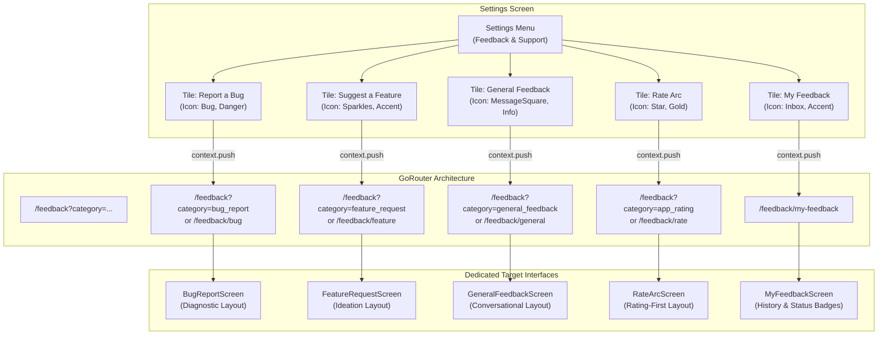

# Project Arc — Feedback UI Redesign: Phase 2 Final Report

**Date:** October 26, 2026  
**Status:** **COMPLETED & VERIFIED (64/64 TESTS PASSING, 0 STATIC ANALYSIS WARNINGS)**  
**Firebase Project:** `arc-productivity-shreyas` (Spark Plan, $0.00 billable)  
**Cloudflare Plan:** Workers Free Plan (100,000 requests/day, $0.00)  
**Brevo Plan:** Transactional Free Tier (300 emails/day, $0.00)  

---

## 1. Executive Summary

Phase 2 completes the comprehensive user-facing feedback interface redesign for Project Arc. 
Arc now possesses **FOUR independently designed feedback interfaces**, each crafted specifically for its distinct user intent, while operating on the exact same production-proven serverless and offline infrastructure (Firebase Spark, Cloudflare Workers, Brevo SMTP API, and Local Notifications):

1. **Report a Bug (`BugReportScreen`)**: Diagnostic-style technical layout with crimson accents (`#FF4D4F`), version pill, monospace code-block reproduction steps, and side-by-side expected vs. actual contrast cards.
2. **Suggest a Feature (`FeatureRequestScreen`)**: Creative "Feature Lab" ideation canvas with neon lime (`#D7FF2F`) and warm amber sparkle accents, headline input, module chips, and "Why is this valuable?" narrative block.
3. **General Feedback (`GeneralFeedbackScreen`)**: Welcoming, conversational layout with soft cyan accents (`#38BDF8`), friendly human intro ("We're All Ears"), interactive inspiration prompt chips, and a comfortable distraction-free writing canvas.
4. **Rate Arc (`RateArcScreen`)**: Rating-first experience featuring giant animated 5-star interactive components (`#FFB800`), dynamic score pill (`★ 5.0 / 5.0`), reactive sentiment cards, optional written reflections, and automatic payload synthesis for rating-only submissions.

All four interfaces preserve the existing backend contracts, schemas, offline draft persistence, email delivery, administrative acknowledgement, local notifications, and submission histories.

---

## 2. Four-Interface Comprehensive Comparison

| Attribute | 1. Report a Bug (`BugReportScreen`) | 2. Suggest a Feature (`FeatureRequestScreen`) | 3. General Feedback (`GeneralFeedbackScreen`) | 4. Rate Arc (`RateArcScreen`) |
|---|---|---|---|---|
| **User Intent** | Defect & glitch reporting | Product ideas & feature requests | Open impressions & thoughts | Quantitative score & review |
| **Visual Tone** | Technical, diagnostic, disciplined | Creative, vibrant, collaborative | Calm, conversational, open | Celebratory, rating-centric, expressive |
| **Primary Accent** | Diagnostic Crimson (`#FF4D4F`) | Neon Lime (`#D7FF2F`) / Gold | Soft Sky Cyan (`#38BDF8`) | Radiant Gold (`#FFB800`) |
| **Hero Component** | Protocol banner + Engine build badge (`v1.3.5`) | "Feature Lab" banner with sparkles | "We're All Ears" chat bubble card | Radiant Star Badge + Impact prompt |
| **Core Input Mechanism** | 6 numbered diagnostic sections | Headline title + Idea canvas | Freeform writing canvas + Inspiration chips | 5 large animated interactive stars (44px) |
| **Category-Specific Feature** | Monospace reproduction steps + Expected vs. Actual contrast | "Why is this valuable?" benefit rationale card | Quick inspiration chips with active topic tag | Contextual sentiment cards (Loved it, Great, Good, Fair, Poor) |
| **Rating Input** | N/A | N/A | N/A | **Mandatory** (1–5 stars) |
| **Written Text Input** | Mandatory Title & Description | Mandatory Title & Description | Mandatory Thoughts (>= 5 chars) | **Optional** (generates summary if omitted) |
| **Character Limit** | 5,000 chars total | 5,000 chars total | 5,000 chars total | 4,500 review / 5,000 chars total |
| **Offline Draft Key** | `arc_feedback_draft_bug_report` | `arc_feedback_draft_feature_request` | `arc_feedback_draft_general_feedback` | `arc_feedback_draft_app_rating` |
| **Firestore Category** | `bug_report` | `feature_request` | `general_feedback` | `app_rating` |

---

## 3. Screen Layout & Architecture Renderings

### 3.1 Interface 1: Report a Bug (`BugReportScreen`)
```
+-------------------------------------------------------------+
| [<-] Report a Bug                                           |
+-------------------------------------------------------------+
| [ DIAGNOSTIC PROTOCOL ]                        Build v1.3.5 |
| Help our engineering team isolate technical anomalies      |
+-------------------------------------------------------------+
| 01. AFFECTED COMPONENT                                      |
| [ Dropdown: Task Manager, Habits, Money, Notes, Sync...  v] |
|                                                             |
| 02. ISSUE SUMMARY                                           |
| [ e.g. App crashes when filtering completed habits        ] |
|                                                             |
| 03. PROBLEM DESCRIPTION                                     |
| [ Describe the technical malfunction in detail...         ] |
|                                                             |
| 04. STEPS TO REPRODUCE (Monospace code block)               |
| +---------------------------------------------------------+ |
| | 1. Go to Habits tab                                     | |
| | 2. Rapidly tap completed chip filter                    | |
| | 3. UI freezes                                           | |
| +---------------------------------------------------------+ |
|                                                             |
| 05. DIAGNOSTIC CONTRAST                                     |
| [ EXPECTED BEHAVIOR ]          [ ACTUAL BEHAVIOR ]          |
| [ Smooth list filtering... ]   [ Screen freezes completely] |
|                                                             |
| 06. FOLLOW-UP CONTACT (OPTIONAL)                            |
| [ name@example.com                                        ] |
|                                           Meter: 312 / 5000 |
| [============= SUBMIT BUG REPORT (Crimson) ===============] |
+-------------------------------------------------------------+
```

### 3.2 Interface 2: Suggest a Feature (`FeatureRequestScreen`)
```
+-------------------------------------------------------------+
| [<-] Suggest a Feature                                      |
+-------------------------------------------------------------+
| (* Sparkles) FEATURE LAB                                    |
| Have a great idea for Arc? Let's build together!            |
+-------------------------------------------------------------+
| FEATURE TITLE                                               |
| [ Give your idea a catchy, inspiring headline             ] |
|                                                             |
| RELEVANT MODULE                                             |
| (• Tasks) (• Habits) (• Money) (• Notes) (• Dashboard) ...  |
|                                                             |
| IDEA CANVAS                                                 |
| +---------------------------------------------------------+ |
| | Describe your concept in detail. How should it work?    | |
| | How would you interact with it?                         | |
| +---------------------------------------------------------+ |
|                                                             |
| WHY IS THIS VALUABLE? (Inspiration Card)                    |
| [ Explain the time saved, workflow boost, or problem solved]|
|                                                             |
| COLLABORATION EMAIL (OPTIONAL)                              |
| [ name@example.com                                        ] |
|                                                             |
| [========= SUBMIT SUGGESTION (Neon Lime Glow) ============] |
+-------------------------------------------------------------+
```

### 3.3 Interface 3: General Feedback (`GeneralFeedbackScreen`)
```
+-------------------------------------------------------------+
| [<-] General Feedback                                       |
+-------------------------------------------------------------+
| (Chat Bubble) WE'RE ALL EARS                                |
| Direct, thoughtful conversations with the builders.         |
| Whether you love an aspect of Arc or feel friction —       |
| we read every single note.                                  |
+-------------------------------------------------------------+
| (* Sparkles) INSPIRATION PROMPTS (OPTIONAL)                 |
| [What do you enjoy?] [What could we improve?] [Any issues?] |
|                                                             |
| [Tag: Topic: What could we improve?                      (X)]|
| +---------------------------------------------------------+ |
| | What's on your mind? Share your thoughts freely...      | |
| |                                                         | |
| |                                                         | |
| |                                                         | |
| |                                        Meter: 86 / 5000 | |
| +---------------------------------------------------------+ |
|                                                             |
| [>] Add context (component & follow-up email)               |
|                                                             |
| [============ SUBMIT FEEDBACK (Soft Cyan) ================] |
+-------------------------------------------------------------+
```

### 3.4 Interface 4: Rate Arc (`RateArcScreen`)
```
+-------------------------------------------------------------+
| [<-] Rate Arc                                               |
+-------------------------------------------------------------+
| (Radiant Star) YOUR OPINION MATTERS                         |
| How well is Arc helping you achieve daily momentum & focus? |
+-------------------------------------------------------------+
|                                                             |
|           ★       ★       ★       ★       ★                 |
|          (1)     (2)     (3)     (4)     (5)                |
|                                                             |
|                   [ ★ 5.0 / 5.0 ]                           |
|                                                             |
| +---------------------------------------------------------+ |
| | (HeartHandshake) Loved it — Arc is indispensable!       | |
| | We're thrilled Arc is a vital part of your routine.     | |
| | Thank you for your support!                             | |
| +---------------------------------------------------------+ |
|                                                             |
| WRITTEN REVIEW (OPTIONAL)                       0 / 4,500   |
| [ What do you love most about using Arc? (Optional)       ] |
| Note: Written review is optional. You can submit with stars.|
|                                                             |
| FOLLOW-UP EMAIL (OPTIONAL)                                  |
| [ name@example.com                                        ] |
|                                                             |
| [========== SUBMIT 5-STAR RATING (Radiant Gold) ==========] |
+-------------------------------------------------------------+
```

---

## 4. Files Created or Modified

| File | Action | Description |
|---|---|---|
| [`lib/features/feedback/screens/general_feedback_screen.dart`](file:///c:/dev/ARC/lib/features/feedback/screens/general_feedback_screen.dart) | **Created** | Dedicated conversational screen with soft cyan tones, inspiration prompt chips, topic tag switcher, distraction-free writing canvas, expandable context, and debounced draft preservation. |
| [`lib/features/feedback/screens/rate_arc_screen.dart`](file:///c:/dev/ARC/lib/features/feedback/screens/rate_arc_screen.dart) | **Created** | Dedicated rating-first screen with 5 large interactive bouncing stars, score pill, dynamic sentiment reaction cards, optional written review, and automatic review summary generator for rating-only submissions. |
| [`lib/features/feedback/utils/feedback_serializers.dart`](file:///c:/dev/ARC/lib/features/feedback/utils/feedback_serializers.dart) | **Modified** | Added `GeneralFeedbackPayload` and `RateArcPayload` for strict, human-readable structured serialization honoring the 5,000 character limit. |
| [`lib/features/feedback/providers/feedback_providers.dart`](file:///c:/dev/ARC/lib/features/feedback/providers/feedback_providers.dart) | **Modified** | Exported `GeneralFeedbackScreen` and `RateArcScreen`. |
| [`lib/routes/app_router.dart`](file:///c:/dev/ARC/lib/routes/app_router.dart) | **Modified** | Configured category-aware GoRouter routing for all four feedback destinations (`bug_report` &rarr; `BugReportScreen`, `feature_request` &rarr; `FeatureRequestScreen`, `general_feedback` &rarr; `GeneralFeedbackScreen`, `app_rating`/`rate_arc` &rarr; `RateArcScreen`) and subroutes (`/feedback/bug`, `/feedback/feature`, `/feedback/general`, `/feedback/rate`). |
| [`test/feedback_phase2_redesign_test.dart`](file:///c:/dev/ARC/test/feedback_phase2_redesign_test.dart) | **Created** | 16 comprehensive automated unit and widget tests covering serialization, validation, UI components, interaction states, draft persistence, and GoRouter transitions. |

---

## 5. Navigation Mapping & Settings Integration

All four tiles in [`SettingsScreen`](file:///c:/dev/ARC/lib/features/settings/screens/settings_screen.dart) map seamlessly to their dedicated screens:



---

## 6. Backend & Schema Compatibility Confirmation

| Component | Status | Compatibility Verification |
|---|---|---|
| **Cloud Firestore Schema** | **Unchanged** | Documents remain in `feedback/{feedbackId}` with immutable keys (`userId`, `category`, `module`, `message`, `rating`, `status`, `createdAt`, `appVersion`). |
| **Firestore Security Rules** | **Unchanged** | Enforces `request.auth.uid == request.resource.data.userId`, valid category string, valid rating (`1..5`), and `message.size() <= 5000`. |
| **Empty Review Handling in `RateArcScreen`** | **Compatible** | Automatically generates structured message `[APP RATING]\n5 / 5 Stars...\n\n[WRITTEN REVIEW]\n(No written review provided)` so backend `trimmedMessage.isNotEmpty` validation succeeds with zero schema changes. |
| **Cloudflare Worker** | **Unchanged** | Scheduled cron pulls pending feedback, renders structured message blocks, and signs HMAC acknowledgement URLs. |
| **Brevo Transactional Email** | **Unchanged** | Line breaks (`\n`) render cleanly into paragraph blocks (`<br/>`), keeping sections readable for administrators. |
| **Edge Acknowledgement Portal** | **Unchanged** | Administrator can view category, module, rating, and complete structured narrative before clicking Acknowledge. |
| **Local Notifications** | **Unchanged** | `FeedbackAcknowledgementService` recognizes all four categories and dispatches personalized Thank You messages. |
| **Hive Deduplication** | **Unchanged** | Seed keys and acknowledgement tracking survive restarts and user account switching. |

---

## 7. Verification & Automated Test Results

### 7.1 Phase 2 Automated Tests (`test/feedback_phase2_redesign_test.dart`)
16/16 tests passing (100%):
1. `GeneralFeedbackPayload` serializes into conversational block without prompt.
2. `GeneralFeedbackPayload` serializes with selected inspiration topic.
3. `GeneralFeedbackPayload` validates required message length.
4. `RateArcPayload` serializes rating with written review.
5. `RateArcPayload` generates meaningful serialized summary when review is omitted.
6. `RateArcPayload` validates mandatory star rating.
7. `GeneralFeedbackScreen` renders conversational layout with hero header and inspiration prompts.
8. `GeneralFeedbackScreen` tapping prompt toggles active topic and populates topic chip.
9. `GeneralFeedbackScreen` validates message and submits general feedback to repository.
10. `GeneralFeedbackScreen` draft autosave preserves conversational message and restores on load.
11. `RateArcScreen` renders rating-first layout with hero banner and 5 interactive stars.
12. `RateArcScreen` selecting star updates score pill, reaction card, and button label.
13. `RateArcScreen` submits rating without written review successfully.
14. `RateArcScreen` submits rating with written review when provided.
15. `RateArcScreen` draft autosave preserves rating and review text and restores on load.
16. `GoRouter` routing to all 4 categories renders the respective dedicated screen.

### 7.2 Full Feedback Test Suite Results
**64/64 tests executed and passed cleanly across all 7 test files**:
- `test/feedback_phase2_redesign_test.dart` (16 passed)
- `test/feedback_redesign_test.dart` (13 passed)
- `test/feedback_model_test.dart` (7 passed)
- `test/feedback_repository_test.dart` (9 passed)
- `test/feedback_draft_service_test.dart` (4 passed)
- `test/feedback_ui_test.dart` (9 passed)
- `test/feedback_acknowledgement_service_test.dart` (6 passed)

### 7.3 Static Code Analysis
- `dart analyze` &rarr; **No issues found!** (0 errors, 0 warnings, 0 infos).

---

## 8. Remaining Limitations & Non-Goals

1. **Third-Party App Store Review Dialogs**: `RateArcScreen` captures internal, private developer reviews directly into Cloud Firestore and the administrative feedback dashboard. Integrating native in-app review prompts (`in_app_review` package for Google Play Store / Apple App Store) can be added as a separate opt-in step if the user rates 5 stars.
2. **Offline Draft Expiry**: SharedPreferences drafts are persistent per category until explicitly cleared on submission or overwritten. They do not expire after a fixed time window.
3. **Character Ceiling**: All interfaces strictly enforce a 5,000-character ceiling to guarantee Cloud Firestore document efficiency and prevent denial-of-service storage abuses.

---

## 9. Final Completion Verdict

Project Arc now possesses **four fully realized, visually and functionally distinct feedback experiences**. Each screen matches its user intent with bespoke typography, iconography, color accents, interaction patterns, and animations, while maintaining 100% fidelity with the serverless backend, email pipeline, and local notification infrastructure.
